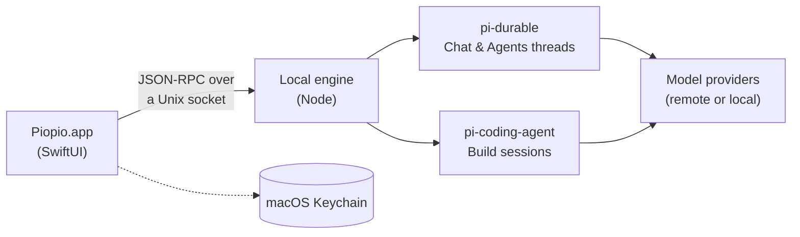

<p align="center">
  <picture>
    <source media="(prefers-color-scheme: dark)" srcset="docs/readme/icon-dark.png">
    
  </picture>
</p>

<h1 align="center">Piopio</h1>

<p align="center">
  <b>A native Mac app for AI agents.</b><br>
  Build software, chat in notebooks and keep personal agents running, all on your Mac.
</p>

<p align="center">
  
  
  
  
  
  <a href="LICENSE"></a>
</p>

<p align="center">
  <a href="#what-it-does">What it does</a> ·
  <a href="#how-it-works">How it works</a> ·
  <a href="#development">Development</a> ·
  <a href="#data-and-costs">Data and costs</a> ·
  <a href="docs/spec/README.md">Spec</a>
</p>

---

Piopio is a front-end for the [pi](https://pi.dev) agent harnesses (`pi-coding-agent` and `pi-durable`). It brings coding sessions, everyday chat and long-running personal agents into one SwiftUI app, with conversations and memory stored on your Mac and credentials in the macOS Keychain.

> [!NOTE]
> **Personal alpha.** Build, Chat/Notebooks and local Agents are implemented (phases 1–4). Cloud is experimental. Real-provider compatibility, OS permissions and daily-use reliability still need broader validation. See [docs/status.md](docs/status.md) for what has and hasn't been checked.

## What it does

<table>
  <tr>
    <td width="33%" valign="top">
      <h3>🛠️ Build</h3>
      <p>Projects and coding sessions with approvals, plans, diffs and rewind. Git and worktrees, a built-in terminal, MCP servers and subagents.</p>
    </td>
    <td width="33%" valign="top">
      <h3>💬 Chat</h3>
      <p>Chats with attachments, branches and export, plus folders to chat about. <b>Notebooks</b> organize messages into topics that share files and memory.</p>
    </td>
    <td width="33%" valign="top">
      <h3>🐣 Agents</h3>
      <p>Local personal agents with schedules, reminders, memory, approvals, budgets, Mac-app abilities and agent-to-agent communication.</p>
    </td>
  </tr>
</table>

**Bring your own model.** Use connected providers, supported subscription sign-ins, or custom and local endpoints. OpenRouter is currently required for the web-search tool.

**Local by default.** Conversations and memory live on your Mac, credentials in the Keychain. Memory search runs by words on this Mac; semantic search is opt-in and explains what it sends.

## How it works



The app talks to a local Node engine that hosts both pi runtimes. Release builds bundle the engine and Node inside the app.

<details>
<summary><b>Repository layout</b></summary>

| Path | What |
|---|---|
| `apps/mac/App` | The SwiftUI app (`project.yml` → XcodeGen; the `.xcodeproj` is generated, not committed) |
| `apps/mac` | Swift package: `PiopioKit` (engine client, protocol types, Keychain, streaming markdown), `PiopioTranscript` (windowed TextKit 2 transcript), `piopio-cli`, and `TranscriptLab` (spike S2 benchmarks) |
| `packages/protocol` | Engine Protocol schemas (TypeBox → JSON Schema) |
| `packages/engine` | Local Engine: Node daemon hosting pi-durable (Threads) and pi-coding-agent (Build) behind JSON-RPC over a Unix socket |
| `packages/runtime` | Shared agent runtime, proactivity, safety and memory |
| `packages/extensions` | Build approvals, plans, checkpoints, todos, notifications and subagents |
| `packages/cloud` | Cloudflare Worker/Durable Object spikes; not a production cloud service |

</details>

## Development

**Requirements:** macOS 27, Xcode 27, XcodeGen (`brew install xcodegen`), Node ≥ 22.19, pnpm 11 (`corepack enable` provides it).

```bash
pnpm install
pnpm build
scripts/build-app.sh   # builds the engine and Piopio.app (Debug); prints the .app path
```

On first launch the app lets you choose areas, connect a model provider and set up your first project, chat or agent. Dev builds run the engine from `packages/engine/dist` with Node from Homebrew (`/opt/homebrew/bin/node`).

> [!TIP]
> Set `PIOPIO_FAUX=1` (in the Xcode scheme) to use the scripted echo model: no API key needed.

<details>
<summary><b>Tests, demos and releases</b></summary>

```bash
pnpm test          # engine, runtime, policy and cloud tests (scripted model; no key needed)
pnpm test:swift    # PiopioKit and PiopioTranscript tests
pnpm demo:s1       # Swift CLI ↔ engine, both runtimes, scripted model
scripts/app-smoke.sh   # launches the app on a scratch data folder with the scripted model and saves a snapshot
scripts/release.sh 0.1.0   # Release app with bundled Node + engine → signed DMG (+ notarization, appcast)
```

Releasing is described in [docs/releasing.md](docs/releasing.md), and backups in [docs/backup.md](docs/backup.md).

To talk to a real model from the command line, store your OpenRouter key in the Keychain and run the demo against OpenRouter:

```bash
apps/mac/.build/debug/piopio-cli key set openrouter
scripts/s1-demo.sh --real
```

Engine environment variables are documented in `packages/engine/src/main.ts`.

</details>

## Data and costs

Conversations and built-in memory are stored locally. Settings › Memory can export built-in memory as JSON and Markdown. Memory searches by words on this Mac by default; semantic search is opt-in and sends memory text and queries to the configured embeddings endpoint.

> [!IMPORTANT]
> Local storage does not mean all processing stays on the Mac. Remote models, web search, connected tools and auxiliary model requests can send content to external services. Auxiliary requests currently prefer OpenRouter when connected, independently of the conversation's model.

OpenRouter usage totals cover the API key, may include other apps and exclude other providers. They are not a complete total of Piopio's costs.

## Documentation

- [Product specification](docs/spec/README.md): product, architecture, engine protocol and each area
- [Current status](docs/status.md): what is implemented and what still needs acceptance
- [Releasing](docs/releasing.md) and [backup](docs/backup.md)

## License

[MIT](LICENSE)

<p align="center"><sub>Pío pío 🐤</sub></p>
