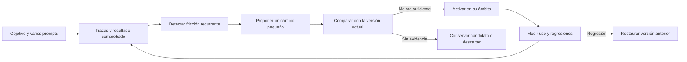

# Piopio que aprende de su uso

Investigación y propuesta, 19 de noviembre de 2026. Basada en fuentes primarias y lectura del código local. No se han ejecutado los sistemas externos ni medido una mejora de Piopio. Los diseños y umbrales propuestos aquí son hipótesis para un experimento.

## Propuesta

Piopio podría mantener una configuración aprendida por proyecto y familia de tareas: procedimientos, selección de contexto, descripciones de herramientas y pequeñas capacidades reutilizables. Un proceso en segundo plano estudiaría tareas terminadas, propondría cambios y los comprobaría antes de activarlos. Las versiones anteriores permitirían deshacer una mejora que deje de funcionar.

El valor para el usuario: cada vez necesita explicar menos cómo trabajar en su proyecto, corregir menos errores recurrentes y esperar menos hasta obtener un resultado comprobado. Esto puede hacerse manteniendo los modelos actuales, sin entrenar sus pesos.

La unidad de aprendizaje debe ser **el objetivo completo**, que puede abarcar varios prompts y conversaciones. Una llamada fallida puede ser una exploración útil; una respuesta convincente puede terminar en trabajo incorrecto. Aprender de un turno aislado confundiría ambas cosas.

## Qué existe fuera

| Referencia | Qué aporta | Qué tomar para Piopio |
| --- | --- | --- |
| [AT-AT, octubre de 2026](https://arxiv.org/html/2610.34679v1) | Optimiza descripciones y, cuando se permite, implementaciones de herramientas a partir de trazas evaluadas. Usa un agente pi. | Es la referencia más directa para optimizar tooling. Evalúa una actualización, no meses de aprendizaje continuo; en Retail no consigue una mejora significativa. Su evidencia exige distinguir variación aleatoria de progreso real. |
| [GEPA](https://arxiv.org/abs/2507.19457) | Examina trayectorias, reflexiona sobre errores y prueba variantes de prompts, combinando soluciones complementarias. | Buscar entre candidatos con evaluación, presupuesto y conservación de alternativas. No basta con pedir al modelo que «mejore el prompt». |
| [ACE](https://arxiv.org/abs/2510.04618) | Organiza contexto como procedimientos que evolucionan mediante generación, reflexión y curación incremental. | Actualizaciones pequeñas con evidencia, evitando que resumir repetidamente borre conocimiento útil. Limitar también el crecimiento del contexto. |
| [Hermes Agent](https://github.com/NousResearch/hermes-agent) | Documenta creación de skills a partir de tareas complejas, revisión durante su uso y búsqueda de conversaciones anteriores. | Referente de experiencia de producto. La existencia del mecanismo no demuestra por sí sola que cada skill aprendida mejore resultados. |
| [Zep Agent Skills](https://help.getzep.com/agent-skills) | Captura ejecuciones, compila procedimientos, revisa candidatos y sirve versiones admitidas. Registra procedencia, uso y resultados. | Separar candidato de versión activa; distinguir intentos independientes de reintentos y autodeclaraciones de éxito de resultados verificados. Es un servicio externo: adoptar su diseño no exige enviarle las trazas. |
| [Letta Context Repositories](https://www.letta.com/blog/context-repositories/) | Memoria como archivos versionados en Git, con lectura progresiva y gestión mediante herramientas. | Aprendizajes inspeccionables y reversibles que acompañan al proyecto. |
| [LangMem](https://langchain-ai.github.io/langmem/reference/prompt_optimization/) | API para optimizar uno o varios prompts a partir de trayectorias, con distintas estrategias. | Referencia de separación entre historial, candidato y política de actualización. No es necesario sustituir el runtime de pi. |
| [Darwin Gödel Machine](https://arxiv.org/abs/2505.22954) y [SICA](https://arxiv.org/abs/2504.15228) | Modifican código del propio agente y evalúan versiones con benchmarks. DGM conserva un archivo de variantes. | Demuestran una vía más ambiciosa de autoedición. Sus experimentos no garantizan fiabilidad en una app personal que trabaja sobre proyectos reales. |

[Anthropic, sobre diseño de herramientas](https://www.anthropic.com/research/writing-tools-for-agents), describe un ciclo práctico de prototipado, evaluación y revisión con agentes: mejorar nombres, descripciones y respuestas puede cambiar la eficacia. Su [guía de evaluación](https://www.anthropic.com/research/demystifying-evals-for-ai-agents) ayuda a separar tarea, intento, verificador y resultado final.

La evidencia tiene distintos niveles: papers con experimentos controlados, documentación de capacidades y propuestas de diseño. No se deben comparar sus porcentajes como si midieran el mismo problema. Ninguna fuente revisada prueba que Piopio vaya a mejorar indefinidamente por analizar más conversaciones.

## Qué hay ya en Piopio

Comprobado por lectura del código, sin ejecutar una evaluación nueva:

| Pieza | Estado y punto de integración |
| --- | --- |
| Eventos de ejecución | [BuildRuntime.attach](../../packages/engine/src/runtimes/build.ts) recibe eventos del SDK; [SdkEventMapper](../../packages/engine/src/timeline/pi-sdk.ts) trata llamadas, resultados, errores y duraciones. Es un punto natural para capturar observaciones. |
| Persistencia de sesiones | Build usa `SessionManager`; el historial permite recuperar intercambios. Eso no equivale a disponer de una tarea reproducible con estado inicial y criterio de éxito. |
| Grabador de eventos crudos | [recorder.ts](../../packages/engine/src/runtimes/recorder.ts) depende de `PIOPIO_RECORD_DIR` y está orientado a fixtures. No es todavía un almacén de aprendizaje activado y gestionado como producto. |
| Métricas | [TimelineBuilder](../../packages/engine/src/timeline/builder.ts) acumula uso; [ExtraCosts](../../packages/engine/src/costs.ts) registra trabajo auxiliar. Haría falta atribuir el coste al objetivo y a la versión experimental, conservando los precios desconocidos como desconocidos. |
| Memoria compartida del proyecto | `notesExtension` lee hasta 6.000 caracteres de `NOTES.md` antes de cada turno y pide conservar información útil. La [especificación reciente](../spec/18-conversation-first.md) actualiza la visión más antigua de memoria de Build. |
| Aprendizaje de hechos | [learnFacts](../../packages/runtime/src/memory/learn.ts) extrae hechos, los añade o sustituye y permite deshacer. Su finalidad actual es recordar información sobre personas, no optimizar procedimientos. |
| Skills y extensiones | Build usa `DefaultResourceLoader`, descubre recursos y aplica confianza del proyecto. Ya hay superficie para cargar capacidades locales. Cargar una skill no implica comprobar su utilidad. |
| Detección de repeticiones | [guards.ts](../../packages/engine/src/tools/guards.ts) y [repeats.ts](../../packages/runtime/src/context/repeats.ts) intervienen sobre llamadas repetidas. Proporcionan señales útiles de fricción. |

Falta conectar estas piezas con un registro de objetivos y resultados, generación de candidatos, pruebas comparativas y activación versionada. La [investigación previa de skills](harness-skills.md) ya propone comparar variantes conservando trazas; esta propuesta convierte ese método en una función del producto.

## Cómo funcionaría

### 1. Observar objetivos, decisiones y resultados

Cada episodio vincularía proyecto, objetivo, conversaciones, intentos y artefactos. Incluiría modelo y versión, configuración efectiva de prompts y herramientas, skills cargadas, revisión del proyecto, llamadas, resultados, duración, tokens y coste disponible.

Una corrección del usuario debe distinguirse de una ampliación del encargo. «Falta la paginación que pedí» es distinto de «ahora añade paginación». Ambas añaden prompts, pero solo una indica retrabajo.

Registrar el resultado con su procedencia: prueba ejecutada, estado observado, aceptación explícita o declaración del agente. La ausencia de quejas queda como resultado desconocido. No hace falta capturar razonamiento privado; bastan acciones observables y sus consecuencias.

### 2. Detectar oportunidades con poco gasto

Primero contadores y reglas: errores de argumentos, búsquedas redundantes, salidas truncadas, secuencias repetidas, correcciones recurrentes o verificaciones omitidas. Después un modelo analiza las agrupaciones que justifican atención, incluyendo éxitos comparables.

Diagnosticar la causa: documentación ambigua, información ausente, herramienta inadecuada, fallo de razonamiento, permisos o servicio externo. Un error transitorio de red no justifica añadir instrucciones permanentes. El optimizador debería poder concluir que no hay nada que cambiar.

### 3. Elegir el cambio mínimo

| Patrón observado | Cambio candidato |
| --- | --- |
| Repite cómo localizar una pieza del proyecto | Guía breve de navegación o recuperación de contexto |
| El usuario corrige repetidamente el mismo procedimiento | Skill con condiciones de uso y comprobación de salida |
| Una herramienta recibe argumentos incorrectos | Descripción, ejemplos o validación más clara |
| Muchas llamadas solo sirven para reunir el mismo contexto | Herramienta compuesta con entradas y resultados explícitos |
| Una respuesta enorme obliga a volver a buscar | Filtro, paginación o resumen estructurado que conserva acceso al original |
| Se repite una tarea con parámetros distintos | Procedimiento parametrizado reutilizable |
| Un flujo funciona con un modelo pero falla con otro | Variante condicionada por modelo; probarla antes de trasladarla |

En MCP externo Piopio puede ajustar su propia presentación o crear un adaptador local; no puede asumir control de la implementación del proveedor. Los contratos y efectos de cada herramienta deben seguir siendo fieles a lo que ejecuta.

### 4. Probar antes de activar

Una traza explica lo ocurrido, pero no permite saber qué habría sucedido con otra herramienta. Para medir comportamiento hay que ejecutar de nuevo desde un estado conocido en un entorno aislado, o esperar nuevas tareas comparables con asignación controlada de variantes.

Separar episodios de descubrimiento, validación y comprobación final. Todos los reintentos del mismo objetivo pertenecen a la misma partición. Incluir casos cercanos donde la skill no deba activarse y conservar casos que ya funcionaban.

Evaluar resultado correcto primero; después retrabajo del usuario, tiempo hasta resultado verificado, coste por tarea resuelta y llamadas innecesarias. Contar también análisis y experimentación. Reducir pasos omitiendo una comprobación no es una mejora.

Los verificadores y casos reservados quedan fuera del alcance de edición del optimizador. Repetir las ejecuciones y registrar incertidumbre: una victoria aislada o una evaluación puramente verbal no justifican activar un cambio de alto alcance.

Las herramientas con efectos externos no se reejecutan contra servicios reales durante la evaluación. Usar dobles de prueba o entornos de ensayo. Los mocks permiten comprobar contratos; por sí solos no demuestran toda la calidad del comportamiento real.

### 5. Activar versiones por ámbito

Cada candidato tendría evidencia, hipótesis, archivos o configuración modificados, ámbito, requisitos, versiones compatibles, resultados comparativos y versión anterior. Estados propuestos: candidato, en evaluación, activo, retirado.

Resolver la configuración al inicio de una tarea y mantenerla fija hasta terminar. Las tareas siguientes pueden recibir otra versión. Evitar que dos procesos cambien una misma skill simultáneamente; detectar conflictos con cambios manuales y no sobrescribirlos.

Ámbitos: tarea, proyecto, usuario y producto. Una práctica útil en un proyecto no pasa automáticamente a los demás. Una mejora general del motor necesita evaluación más amplia y el proceso normal de distribución.

## Qué aplicaría automáticamente

Con el aprendizaje habilitado para un proyecto, permitiría activar procedimientos y ajustes locales que superen los criterios, dentro de los permisos existentes. Dejaría una entrada discreta con el cambio, su evidencia y Deshacer. Es una decisión inicial de producto; no requiere preguntar por cada aprendizaje.

El código generado empezaría como candidato aislado. Las herramientas compuestas deberían ejecutar sus pasos mediante el mismo sistema de permisos, cancelación y registro que las herramientas originales. Si eso no puede garantizarse, permanecerían como propuestas revisables.

Los cambios de permisos, nuevas credenciales, instalación de dependencias y efectos externos mantienen su autorización propia. El optimizador no puede ampliarla para mejorar su puntuación. Los cambios del motor distribuido se prepararían como parches verificables, fuera de la activación personal de skills.

Tratar las trazas como datos potencialmente no fiables: una página o salida de herramienta puede incluir instrucciones que no deben convertirse en una skill autorizada. Conservar procedencia y excluir secretos. Respetar exclusiones, chats temporales y el proveedor permitido; procesamiento en segundo plano también puede enviar datos fuera del Mac.

## Ejemplo de uso

El usuario construye varias pantallas de administración. En distintos objetivos vuelve a pedir que respeten permisos, añadan estados vacíos, conecten la paginación y comprueben el resultado visible.

Piopio agrupa los casos, comprueba cuáles eran requisitos originales y propone un procedimiento para pantallas de ese proyecto. El procedimiento indica qué contratos consultar, cómo reutilizar componentes y qué estados verificar. Si las trazas muestran muchas búsquedas repetidas, propone además una herramienta que reúna ese contexto.

Son dos experimentos separados: procedimiento primero, herramienta después. Así se puede atribuir el resultado a cada cambio. La siguiente petición compatible recibe la versión validada sin que el usuario repita todas las instrucciones. Una petición de explicación de código no debería activar construcción ni edición.

La interfaz podría mostrar «He aprendido cómo preparar estas pantallas en este proyecto» con acceso al procedimiento, evidencia y Deshacer. Los porcentajes de ahorro solo se mostrarían cuando existan mediciones comparables, con tamaño de muestra y periodo.

## Primer experimento

1. Instrumentar una familia frecuente de tareas en un proyecto. Guardar objetivos, correcciones, resultados, versiones y costes. Analizar al terminar el objetivo o tras inactividad, con presupuesto explícito.
2. Reunir como punto de partida 20–30 episodios independientes, incluyendo fallos y éxitos. Es una muestra exploratoria propuesta, no un mínimo estadístico demostrado. Si no hay suficiente recurrencia, mantener los candidatos sin activar.
3. Reservar casos antes de generar mejoras. Comparar Piopio actual con una única skill aprendida. Mantener modelo, herramientas y estado inicial equivalentes, repetir intentos y comprobar activaciones indebidas.
4. Si hay señal útil, probar por separado una mejora pequeña del tooling. Exigir que respete contratos y permisos y que no degrade los casos que ya funcionaban.
5. Activar de forma limitada en tareas futuras, mantener una referencia comparable y restaurar la versión anterior ante regresiones. Si se reutiliza muchas veces el conjunto reservado para elegir candidatos, renovarlo.

La condición de avance sería mejorar resultados o reducir retrabajo/coste con calidad preservada y evidencia suficiente. Un ahorro neto debe descontar el coste de aprender y evaluar. Cuando cambie el modelo, las herramientas o el proyecto, reevaluar las mejoras afectadas y retirar las que ya no compensen.

Empezaría por **trazas → procedimientos → evaluación → activación local**. El siguiente nivel sería adaptar herramientas; la autoedición general del motor vendría después. Cada nivel necesita señales y permisos distintos, aunque comparta el mismo ciclo de aprendizaje.
